# Architecture

This project adapts the provided monolithic Next.js reference to the requested **Next.js frontend plus separate Express API**. Node.js runs both services. React uses Lucide React icons and locally owned shadcn/ui components.

```mermaid
flowchart LR
  UI[React feature components] --> Redux[Redux slices and thunks]
  Redux -->|fetch /api with cookies| Next[Next.js same-origin proxy]
  Next --> Express[Express resource routes]
  Express --> Auth[Verified Supabase session]
  Auth --> Controller[Controllers]
  Controller --> Service[Services: business conditions]
  Service --> Repository[Repositories]
  Repository --> Prisma[Prisma and pg adapter]
  Prisma --> DB[(Supabase Postgres)]
```

## Layers

| Layer | Location | Responsibility |
| --- | --- | --- |
| Page | `src/app/{entity}/page.tsx` | Thin App Router page shell |
| Feature UI | `src/components/{entity}/` | List orchestration, table, shared form, dialogs |
| Shared UI | `src/components/ui/`, `src/components/common/` | shadcn primitives, async status |
| Client state | `src/lib/store/` | Types, request thunks, reducers, typed hooks |
| Proxy | `next.config.ts` | Forward `/api/*` to `API_ORIGIN` |
| API entry | `src/server/index.ts`, `app.ts` | Start Express, middleware, errors |
| Routes | `src/server/routes/` | index.ts registers endpoints/resource routers/404; resource files apply auth and dispatch controllers |
| Controllers | `src/server/controllers/` | Validate inputs, map results to HTTP responses |
| Services | `src/server/services/` | Business conditions, workflows and transaction orchestration |
| Repositories | `src/server/repositories/` | Database queries; no HTTP code |
| Database client | `src/server/prisma/client.ts` | Lazy Prisma singleton with pg adapter |
| Authentication | `src/server/auth/` | Cookie adapter and verified Supabase user |

Do not add Next.js API handlers for business resources. Do not import backend modules into React components or Redux. Express files cannot use Next.js `server-only`; ESLint checks the frontend boundary. Redux providers create a store per mounted application, rather than sharing a singleton across server requests.

## Resource conventions

One Express router per resource; identity uses `GET/DELETE ?id=uuid` and PATCH body `{ id, title }`. Errors use `{ "error": "Human-readable message" }`. Malformed JSON and invalid inputs return 400, unauthenticated calls 401, disallowed origins 403, missing/unowned resources 404, and unexpected failures a generic 500.

For future per-user resources, derive ownership from the verified session and constrain every repository query by that owner. Profiles are provisioned by the seed or super-admin users API. Both password and Google login require an existing profile; protected-request middleware enforces this too.

Redux slices own resource types and HTTP requests, using `credentials: "include"`. List components dispatch fetches, show loading/errors, redirect on 401, and wire table actions to dialogs. Dialogs keep local open/pending state and close only after successful mutations.

## Add a CRUD resource

1. Add a snake_case Prisma model with `user_id` when the data is per-user. Run `npm run db:migrate -- --name add_resource` and generate the client.
2. Create `src/server/repositories/{entity}_repository.ts`; scope every query by the authenticated user.
3. Create `src/server/services/{entity}_service.ts` for conditions and workflows, then `src/server/controllers/{entity}_controller.ts` for inline validation and consistent HTTP errors. Use matching singular camelCase operation names, such as `listRole`, `createRole`, `editRole`, `updateRole` and `deleteRole`; see [code conventions](CODE_CONVENTIONS.md).
4. Create `src/server/routes/{entity}.ts`, apply `requireAuthUser`, and mount it in `src/server/routes/index.ts`. `app.ts` mounts that root router after shared middleware and before the error handler.
5. Extend paths and schemas in `src/lib/openapi.ts`.
6. Create an entity slice and register its reducer in `store.ts`.
7. Create the feature's list/table/form/dialogs and create a thin App Router page.
8. Add navigation, then run lint, typecheck, tests, and build. Verify CRUD with a real database and two users to check isolation.

Generated Prisma code is never edited or committed. Commit schema changes and SQL migrations together. Apply migrations separately from builds. Swagger uses `swagger-ui-dist` loaded on the client for React compatibility.

## Dependency maintenance

The lockfile includes targeted overrides for Prisma CLI's `deepmerge-ts` and `mysql2` dependencies to address their published advisories without downgrading Prisma. Generation and the build have been verified with these overrides. Remove them once upstream packages adopt the patched versions.

At scaffold verification on 2026-10-05, `npm audit --omit=dev` reported no runtime advisories. The full audit reported five high-severity development-tool entries arising from the `braces` dependency chain in Next.js's ESLint plugin. The registry's current `braces` release had no patch; the suggested forced fix would downgrade the Next.js lint configuration to version 14. Keep track of the upstream fix rather than forcing that incompatible downgrade.

Lint, typecheck, API tests, and the Next.js production build passed. A production smoke check returned 200 for all application pages, proxied health, and proxied OpenAPI. Real login and future persisted resources require configured Supabase credentials and an applied database migration; they have not been verified against an external database.

See [Security](SECURITY.md), [Folder structure](FOLDER_STRUCTURE.md), and [Setup](../README.md).

## Sidebar catalog

`src/lib/auth/catalog.ts` registers Dashboard, Users, Roles and Companies. `src/lib/auth/dashboard.ts` defines the dashboard home path. `src/app/layout/sideBarMenuItems.ts` gives the verified global `super_admin` role all catalog pages, including future registered pages. Other users require explicitly allowed page keys and any applicable `view_permission`. Grouped menus include only allowed children and disappear when none remain. Register new pages in the catalog and icon map.

`AppSideBar` reads the verified session's global role and renders icons, active links and nested groups on desktop/mobile. The shared shell supplies dashboard home by default. `super_admin` bypasses navigation grants; fetching company-scoped grants for ordinary users remains future work. Navigation filtering does not enforce API authorization. The page proxy protects Dashboard and requires `super_admin` for Users, Roles and Companies; the users API independently verifies that global assignment. Users, Roles and Companies share `src/app/(app)/layout.tsx`.
