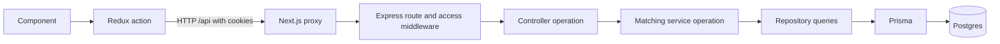

# Backend structure and request flow

Resource controllers declare async operation handlers that match their service operations and may keep request validation and HTTP error helpers locally. If the service exposes `create_user`, the controller exposes `create_user`. Users, Roles, and Companies keep validation and HTTP error helpers in their controllers. Rate limiters belong in routes.

This guide describes the structure used by Users, Roles, and Companies. Authentication currently retains its own controller helpers and service object; it has not yet been converted to the resource controller pattern.

## Request flow



The service returns data to the controller, which sends the HTTP response. Redux receives that response and updates client state. Components render the result.

## Files for a resource

Users provides a concrete example:

```text
src/
  components/users/                 User forms, dialogs, tables and cards
  lib/store/users-slice.ts          API requests and client state
  server/
    schema/users_schema.ts         Server-only request and record types
    routes/users.ts                URLs, access middleware and rate limiting
    controllers/users_controller.ts
                                   HTTP handlers, input validation and error responses
    services/users_service.ts      Business conditions and creation workflow
    repositories/users_repository.ts
                                   Database queries, Prisma filters and serialization
    utils/pagination.ts            Shared pagination parsing
```

Files use the plural resource name (`users_controller.ts`). Operation names use the singular entity (`create_user`). Runtime backend modules stay on the server.

## Server schema and frontend types

`src/server/schema` and `src/types` are separate contracts. Do not import one from the other.

| Location | Used by | What belongs here |
| --- | --- | --- |
| `src/server/schema/{resource}_schema.ts` | Controllers, services, repositories, and input parsers | Sort-field allowlists, the record the repository returns, and create/update inputs |
| `src/types/{resource}.ts` | Components and Redux | Page, response, options, and other shapes the UI reads from HTTP JSON |

Declare the server types in the schema file. Copy the fields the server needs, including a nested company as `{ id: string; name: string }`, instead of re-exporting `src/types`. Leave page, response, and options types in `src/types`. Shared auth values such as `AccessScope` may still be imported from `src/lib/auth`.

## Responsibilities

| Layer | What belongs here | User creation example |
| --- | --- | --- |
| Component | Form values, interaction and rendering | Collect name, email, password and optional assignments |
| Redux | HTTP requests, loading/error/data state | Send `POST /api/users`, retain the returned user |
| Route | URL/method registration, access middleware, rate limiting | Apply verified session, super-admin access and creation limiter |
| Controller | Read request input, invoke validation, call service, send success or error response | Call `create_user`, return `201` with `{ user }` |
| Controller | Field validation, normalization and HTTP error translation | Trim name, normalize email, reject invalid IDs, map duplicate errors to `409` |
| Service | Business conditions, transactions and external operations | Check assignments, create Auth account, coordinate profile persistence and cleanup |
| Repository | Database reads/writes and record serialization | Find available assignments and persist the user and memberships |
| Schema contract | Server-only record and write types | `CreateUserInput`, `UpdateUserInput`, `UserSummary` |

## Controller standard

A controller file declares only its implemented resource operations using named async functions. Each handler validates and normalizes input inside its `try` block, calls the matching service operation, and translates failures inside its `catch` block. See [the users controller](../src/server/controllers/users_controller.ts) for the complete implementation.

The optional service dependency lets tests supply a replacement without changing the route. Express supplies the normal request, response and next arguments in production.

The users controller declares only its implemented operation handlers, with request validation and error translation inline. Put `create_user_limiter` in `routes/users.ts`.

Keep request validation and HTTP error helpers in the resource controller. Database queries belong in repositories, and business decisions belong in services.

## Validation and business conditions

Validation asks whether the supplied input has an acceptable shape and format. Business conditions ask whether the requested operation is allowed for the current records.

| Check | Location |
| --- | --- |
| Name is a nonempty string within its length limit | Controller |
| Email has a valid format and needs normalization | Controller |
| Company ID is a UUID | Controller |
| Role IDs are distinct and within the count limit | Controller |
| Assigning roles requires a company | Service |
| Selected company and company roles are available | Service, using repository lookup results |
| Email already belongs to an account | Service, using repository lookup results |
| Insert user, membership and role assignments | Repository |

Services accept validated values and return data or raise application errors. They do not accept Express request/response objects or choose HTTP status codes. Repositories execute queries; services interpret their results.

## Naming standard

Use `snake_case`, with the action followed by a singular entity, for backend operations. Match controller and service operation names.

| Operation | Controller | Service | Repository |
| --- | --- | --- | --- |
| List users | `list_user` | `list_user` | `list_user` |
| Create user | `create_user` | `create_user` | `create_user` |
| User form choices | `get_user_option` | `get_user_option` | `get_user_option` |
| User filter choices | `get_user_filter_option` | `get_user_filter_option` | `get_user_filter_data` |
| Load role for editing | `list_by_id_role` | `list_by_id_role` | `list_by_id_role` |
| Update company | `update_company` | `update_company` | `update_company` |

Repository names may describe a supporting query used by a service, such as `assignable_user` or `list_by_id_role`. Services can also have internal business helpers. These supporting functions do not need controller endpoints.

Frontend Redux actions keep camelCase, such as `createUser` and `listUser`. Types and classes use PascalCase, such as `CreateUserInput` and `UserError`. External APIs retain their library names.

Only add implemented operations. Users currently exposes `list_user`, `create_user`, `get_user_option`, and `get_user_filter_option`; do not add placeholder edit/update/delete handlers.

## Creation example from start to finish

1. The form dispatches `createUser(input)` through Redux.
2. Redux sends the body to `POST /api/users` with session cookies.
3. The Next.js proxy forwards the request to Express. Shared middleware checks the request origin, and the Users route applies authentication, super-admin authorization and rate limiting.
4. Controller `create_user` normalizes and validates the body inline.
5. Service `create_user` uses repository `assignable_user` to check the existing email, company and role availability. It checks those business conditions before creating the Supabase Auth account.
6. Repository `create_user` persists the matching user profile and optional memberships/roles in a database transaction.
7. The controller returns `201` with `{ user }`. Redux records the result, and the form can close and refresh the list.

If persistence fails after Auth creation, the service attempts to delete the newly created Auth account before rethrowing the error. The controller then translates the error into an HTTP response. Auth creation and Postgres persistence do not share a transaction.

`createUser` is a manual thunk that keeps passwords out of Redux actions and state. Await `dispatch(createUser(input))` directly; it returns the user or rejects. Keep passwords in local form state.

## Response and error conventions

| Status | Use |
| --- | --- |
| `200` | Reads, options, updates and deletion |
| `201` | Resource creation |
| `400` | Invalid input, invalid pagination or rejected business input |
| `401` / `403` | Missing/invalid session or denied access |
| `404` | Missing resource |
| `409` | Duplicate or conflicting records |
| `429` | Rate limit reached |
| `502` | External provider failure where mapped by the resource |
| `500` | Unexpected failure with a generic response |

Errors use `{ error: "Human-readable message" }`. Controller helpers map application error reasons and known database codes to safe responses. Unexpected failures must not expose SQL, credentials or internal error details. The shared application error handler covers parser errors and failures outside resource controllers.

## Adding a resource

1. Define the server record and write types in `server/schema/{resource}_schema.ts`. Put the frontend page, response, and options types in `src/types/{resource}.ts`.
2. Add validation and HTTP error helpers in the resource controller.
3. Add database operations in `server/repositories/{resource}_repository.ts`.
4. Add business operations in `server/services/{resource}_service.ts`.
5. Add matching named async handlers in `server/controllers/{resource}_controller.ts`.
6. Register routes, access middleware and rate limits, then mount the router in `server/routes/index.ts`.
7. Document the API in OpenAPI and add Redux requests and feature components.
8. Verify validation, business conditions, responses and access boundaries. Run the checks appropriate to the change.

See [code conventions](CODE_CONVENTIONS.md) for transaction and naming details, [architecture](ARCHITECTURE.md) for the application layers, and [folder structure](FOLDER_STRUCTURE.md) for the full project layout.
