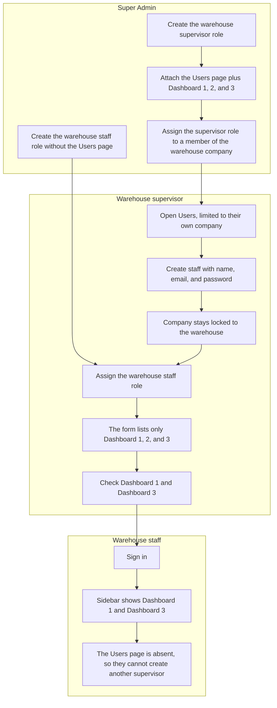

# Company supervisors and staff

A company supervisor creates staff on the Users page and checks the dashboards that person can open. Super Admin still creates the shared roles. See [Users](USERS.md), [Roles](ROLES.md), and [Users, roles, and companies](DATA_MODEL.md).

A warehouse supervisor creates staff for their own company and chooses which of their dashboards that person can open. Super Admin decides who is a supervisor by putting the Users page on that person's role.

`warehouse_supervisor` and `warehouse_staff` are not seeded. Super Admin creates those company roles in Roles and attaches pages there. "Staff" here means an account the supervisor creates. It is separate from the later sales Agent in [Project features](FEATURES.md).

## Flow

## Who does what

| Person | How they get access | What they can do |
| --- | --- | --- |
| Super Admin | Global `super_admin` role | Creates companies, roles, and pages. Assigns the supervisor role. Sees every company on Users. |
| Warehouse supervisor | A company role that includes the Users page | Creates and updates staff in their own company. Hands out dashboards they already have. |
| Warehouse staff | The staff role plus the dashboards checked for that membership | Opens only those dashboards. Cannot open Users or create another supervisor. |

Having the Users page is what makes someone a supervisor. There is no separate head flag.

## Dashboards the supervisor can assign

The form lists a page only when both of these are true:

1. The page is on the supervisor's own role.
2. The page is not the Users page.

The supervisor types a role name, or presses a chip under that field to reuse a role this company already has. The newest role is selected first. `Warehouse Staff` is stored as `warehouse_staff`. That slug is unique across the app. If another company already uses it, this company's slug adds part of the company id. Selecting an existing role assigns that role and does not create another one. For each checked dashboard the supervisor chooses View, Edit, Create, and Delete, then **My company** or **Only me**. **All** stays on the Super Admin role form. Those choices cannot be broader than the supervisor's own grant.

The supervisor checks a subset. Dashboard 1 and Dashboard 3 can be saved while Dashboard 2 stays off. A later staff member in the same company can receive a different subset.

The supervisor can change that staff member's dashboards after creation. The same three rules apply.

## Where the checks are saved

`user_company.page_grant_mode` chooses how that membership gets pages:

| Mode | Who it is for | What the sidebar uses |
| --- | --- | --- |
| `role_pages` | Supervisor, and anyone Super Admin assigns. This is the default. | Every page on the assigned role, including Users. Rows in `user_company_page` are ignored. |
| `assigned_pages` | Staff created or updated by a supervisor | Only pages that are both checked on that membership and present on the staff role. An empty list means no dashboards. |

Checked pages are stored on `user_company_page` (`user_company_id`, `page_key`). The company role is not rewritten per staff member.

The checked actions are stored on `user_company_permission` for that staff member. The role keeps a copy so the membership cannot grant an action the role does not have. Create has no scope menu. Super Admin does not see this permission menu.

## Screen

Company supervisors use the existing Users page, filtered to their own company. The create form keeps name, email, password, and password confirmation. The company field is their company. Under email they enter a role name or press an existing-role chip, then check dashboards. Super Admin does not see the role field. The assign dialog lists only that company's roles and keeps the dashboard checks. Supervisor scope menus offer My company and Only me.

Super Admin keeps the current Users page across companies. `/users` opens for a company user whose access includes the Users page. `/roles` and `/companies` stay limited to `super_admin`.

## Still out of this version

- Letting a supervisor grant the Users page.
- Letting a supervisor change view, add, edit, or delete inside a dashboard.
- Seeding `warehouse_supervisor` or `warehouse_staff`.
