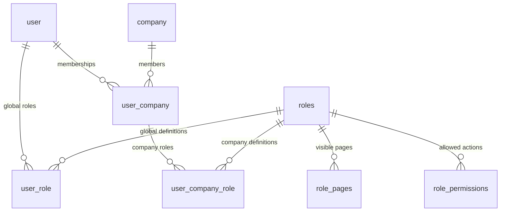

# Users, roles, and companies

Supabase Auth owns login credentials. `user.id` must be the same UUID as the Supabase Auth account; profiles do not store passwords.

Warehouse locations, purchase orders, receiving, stock, and user ↔ location turnover are designed in [Warehouse inventory](WAREHOUSE_INVENTORY.md). Feature status lives in [FEATURES.md](FEATURES.md). Those modules are not in this schema yet; this document remains the RBAC and company assignment source of truth.



## Assignment rules

- `roles.scope = global`: assign through `user_role`, for example `super_admin`.
- `roles.scope = company`: assign through `user_company_role` to an existing membership.
- `user_company` has a unique `(user_id, company_id)` pair. A user can belong to multiple companies without duplicate memberships.
- Each membership can have multiple company roles. A user could be manager in Company A and staff in Company B.
- Company role definitions are shared templates across companies. Assignments, rather than definitions, are company-scoped. If companies later need private custom role definitions, add explicit company ownership to the role model and matching constraints.
- Slugs are globally unique stable identifiers, for example `super_admin`, `manager`, and `staff`. `is_system` marks roles managed by the application; it does not confer privileges by itself.
- `is_default_role` marks the one optional company role to assign when creating memberships. There is no automatic assignment trigger; the membership service must assign it. A database partial unique index allows at most one default role, and a CHECK forbids default global roles.

Composite foreign keys and CHECK constraints enforce assignment scope. A company role cannot be inserted into global assignments, and a global role cannot be inserted into company assignments. Referenced roles cannot be deleted or have their scope changed while assigned. Remove or replace their assignments explicitly first.

Deleting a user removes their memberships and assignments. Deleting a company removes its memberships and their role assignments. Deleting an unassigned role removes its page and permission mappings. Removing a membership removes its company roles, while global assignments remain independent.

All new tables have RLS enabled without public policies, matching the backend-only database access pattern. Prisma models define the schema and Prisma Migrate manages committed SQL; the SQL also defines custom CHECK constraints, partial indexes and RLS. Apply committed migrations with `db:deploy`. The unique nullable profile email retains compatibility with the existing authentication repository; multiple NULL emails are allowed, but duplicate non-NULL emails cause migration failure and must be resolved beforehand. Parameterized Prisma queries and seed writes live in repositories.

## Super-admin workflow

1. Verify the caller's Supabase session and global `super_admin` assignment on the server.
2. Create or invite the login account through Supabase Admin API using a backend-only secret key.
3. Upsert its profile using the Auth account UUID.
4. Create a company and role definitions as needed.
5. Create the user's `user_company` membership.
6. Assign company roles through `user_company_role`. Assign global roles through `user_role` separately.

Use a Prisma transaction for related API database assignments. Supabase Auth creation happens outside that database transaction, so provisioning must handle partial failure and retry using the same account ID. The seed retains its Prisma transaction.

The model stores permissions; it does not implement permission enforcement. Future controllers must check permissions for the requested company, validate stable page/permission keys, protect system roles, and prevent removal of the last super-admin. Hiding a page is UI behavior, not authorization. The current app exposes login/logout/session and public health/API documentation endpoints. `prisma/seed.ts` provisions the first global super-admin; administration APIs are separate work.

## Apply

```sh
npm run db:deploy
```

The migration is committed but not applied automatically. It adds the new tables and makes profile email unique; it does not provision any accounts or roles.
