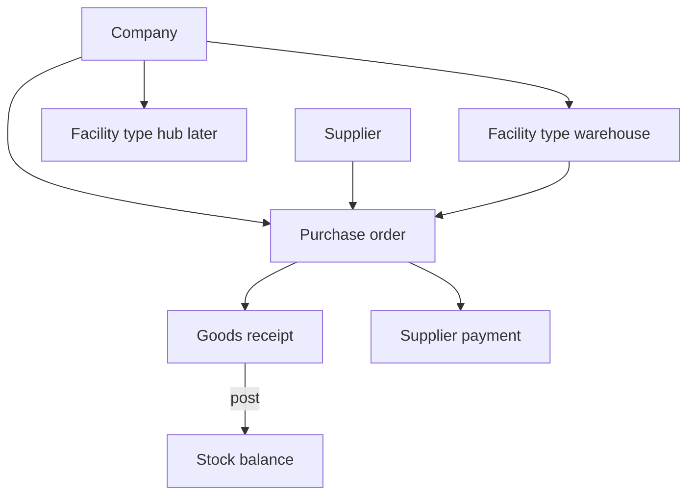
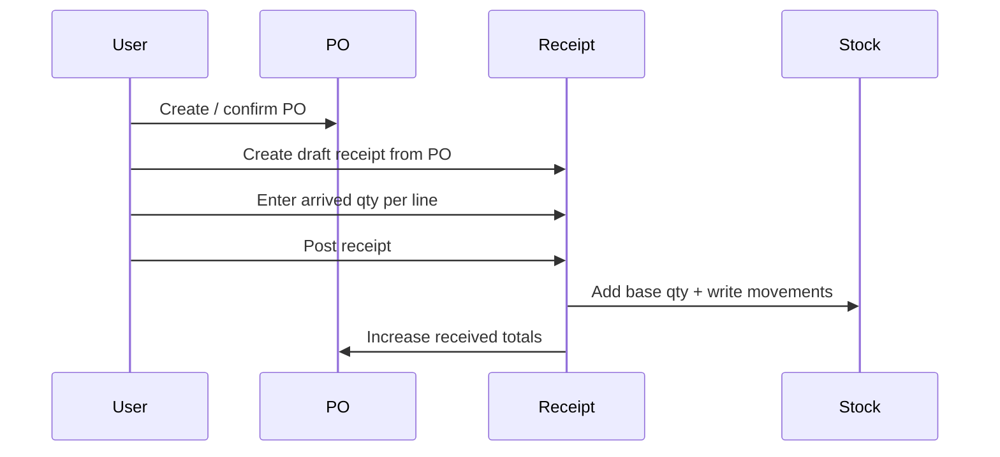

# Warehouse inventory

Design basis for Central Warehouse **supplier** purchasing, receiving, stock, facility assignment, turnover, and supplier payments. The full B1G Fuel System feature list (Super Admin, Sales Manager, Agent, Client, inventory balance reports, CRM, client orders, PayMongo checkout, etc.) lives in [FEATURES.md](FEATURES.md). This document is the agreed how-to for the near-term warehouse stock path only.

**Naming:** A *supplier purchase order* (this doc) is warehouse buying from a supplier. A *client purchase order* in FEATURES.md is a sales order from a client and is out of scope here.

## System context

B1G Fuel moves butane-related stock through a **company**, into a **warehouse facility**, and later out to **hub** facilities.

| Concept | Role |
| --- | --- |
| Company | Tenant that owns facilities, POs, stock, and assignments |
| Facility (`warehouse`) | Physical stock site that receives supplier goods |
| Facility (`hub`) | Downstream site (same table, later) |
| Role (RBAC) | What a user may do (pages and permissions) |
| User ↔ facility | Where a user may act (changeable assignment) |

A company is never itself a warehouse. A “Warehouse” role is never itself a facility. Shared catalog rows (suppliers, brands, measurements with `company_id` null) are visible across companies; they are not hubs of one company.



## Core rules

1. Stock quantity is stored only in **base units** (for example PCS) per product per facility.
2. Conversion factors (for example 1 CRATE = 12 PCS) live per **product per facility**, not on `measurement_unit`.
3. A **draft** document never changes stock. **Posting** a goods receipt is the first stock increase.
4. Posted receipts are immutable. Corrections use adjustments later.
5. Purchase orders plan and track what was ordered; receiving posts what arrived.
6. Payment terms and preferred method are commercial fields on the PO. Payment proof belongs on a **payment** record.

---

## Facilities

The dedicated [Hubs module](HUBS.md) now manages company-owned `facility` rows with `type = hub`, including the page, Redux API requests, and staff assignments. Warehouse facility CRUD and inventory requests/transfers remain separate work.

### Purpose

Facilities answer *where* stock sits and *where* a PO will receive goods. Create them in a Facilities module (catalog-style CRUD), company-scoped.

### Suggested fields

| Field | Notes |
| --- | --- |
| `id` | UUID |
| `company_id` | Required; facility always belongs to one company |
| `name` | e.g. Central Warehouse |
| `type` | Prisma/Postgres enum `facility_type`: `warehouse` \| `hub` |
| `code` | Optional short code |
| `address` | Optional |
| `is_active` | Soft-disable without deleting history |
| `created_by` | Who created the row (audit only, not current owner) |

Unique per company on `(company_id, name)` and/or `(company_id, code)`.

Facilities are **not** shared globally (`company_id` is never null). Start with one warehouse per company when possible so PO create can auto-select it.

**Company create shortcut:** creating a company may optionally include `facility_name` / `facility_address`. When provided, a `warehouse` facility is created in the same transaction. Company-only create remains valid. A dedicated Facilities module still manages further warehouses and hubs.

### RBAC vs facility

| Piece | Responsibility |
| --- | --- |
| Warehouse role | Grants pages such as Facilities, Purchase orders, Receiving |
| Facility row | The warehouse or hub itself |
| User ↔ facility | Restricts which facilities that user may pick |

v1 may allow any facility in the user’s company. v2 should filter pickers by assignment.

---

## User ↔ facility assignment and turnover

### Assignment

Store a separate link (for example `user_facility` or assignment on the membership), not a `user_id` owner column on `facility`.

```text
facility              → belongs to company (stable)
user_facility         → user may work at that facility (changeable)
role / permissions    → what actions they may perform
```

- One facility can have many users over time.
- One user can have one or more facilities.
- `facility.created_by` is audit only. It does not mean “current warehouse owner.”

### Turnover (hand over warehouse to another user)

When clerk Ada leaves and Ben takes over Central Warehouse:

| What | Action |
| --- | --- |
| Facility row | Unchanged (same id, company, name, stock) |
| Ada | Remove her `user_facility` for that warehouse (and/or warehouse role) |
| Ben | Add `user_facility` for the same warehouse + warehouse role |
| Historical POs / receipts | Unchanged `facility_id` and original `created_by` |

**Only the assignment’s user changes.** Stock, company, and document history stay on the facility.

Do not:

- Move `facility.company_id` when staff changes
- Treat `created_by` as the live owner
- Rewrite old POs to Ben’s user id

---

## Products and conversion

### Product

A sellable/stockable item ties a **variant**, a **product type**, and one **base measurement unit** (for example PCS).

- **`product_type`** is a dynamic catalog (no enum): name + key; optional `company_id` (shared when null). Seed **New** / **Refill**.
- **`product`** is company-owned: `company_id`, `variant_id`, `base_unit_id`, `product_type_id`, optional `note`. No product `name` — UI shows `brand variant · type`.
- Unique: `(company_id, variant_id, product_type_id)`.
- PO lines and stock balances reference `product_id`, not raw variant alone.

### Conversion

At a facility, for a product, define how a receive unit converts to the base unit:

| Example | Factor |
| --- | --- |
| 1 CRATE → PCS | 12 |

Posting a receipt without a conversion for that product at that facility is refused. Snapshot the factor on the receipt line so later conversion edits do not rewrite history.

---

## Purchase orders

### Purpose

A purchase order (PO) is the warehouse’s order from a **supplier** into a **warehouse facility**. It does not increase stock. Receiving against the PO does.

### Header

| Field | Required | Notes |
| --- | --- | --- |
| `company_id` | Yes | From the creating user’s company (same pattern as supplier create) |
| `facility_id` | Yes | Warehouse that will receive the goods |
| `supplier_id` | Yes | Existing suppliers catalog |
| `status` | Yes | e.g. `draft` → `open` / `ordered` → `closed` (and payment status separately or derived) |
| `payment_terms` | Yes (once confirmed) | COD, Net 15, Net 30, free text or catalog later |
| `payment_method` | Optional | Preferred method: cash, bank_transfer, gcash, check |
| `estimated_delivery_at` | Recommended | Expected arrival date |
| `created_by` | Yes | Audit |
| notes | Optional | Free text |

### Lines

| Field | Notes |
| --- | --- |
| `product_id` | What is ordered |
| `unit` / unit id | Unit the buyer typed (CRATE, PCS, …) |
| `ordered_qty` | Quantity ordered in that unit |
| `received_qty` | Filled as goods receipts post (running total) |

Partial receipts are allowed: ordered 10 crates, received 8, PO stays open until complete or manually closed.

### Status behavior

| Status | Editable header/lines | Stock effect |
| --- | --- | --- |
| `draft` | Yes | None |
| `open` / `ordered` | Lines usually frozen; ETA may still update | None until receive |
| `closed` | Read-only | None |

Payment terms freeze when the PO leaves draft. Preferred payment method may stay as a hint; actual method is recorded on each payment.

### Company capture

On create, `company_id` comes from access rules (company user forced into their company; super-admin follows the same pattern used for suppliers). Every PO also stores `facility_id` for the warehouse under that company.

---

## Receiving (goods receipt against PO)

### Purpose

Receiving records what physically arrived for an open PO and, on **post**, increases warehouse stock.

### Flow



### Receipt header and lines

**Header:** `purchase_order_id`, `facility_id` (from PO), `status` (`draft` | `posted`), `created_by`, `posted_by`, `posted_at`.

**Lines:** product, unit received, qty received, snapshotted conversion factor, base qty (`qty × factor`).

### Draft vs posted

| State | Behavior |
| --- | --- |
| Draft | Editable / deletable; no stock change |
| Posted | Immutable; cannot post twice |

### Posting (one transaction)

1. Refuse if there are no lines, or any line lacks conversion for that product at that facility.
2. Snapshot factor and base quantity on each line.
3. Add base quantity to `inventory` for `(facility_id, product_id)`.
4. Write one stock movement per line (`type = po_receive_in`, qty in, link to receipt line).
5. Update PO line `received_qty` and close the PO when fully received (or leave open if partial).
6. Mark receipt `posted`.

Mistakes after post are fixed with **adjustments**, not by editing the receipt.

Receiving does **not** set payment terms, does **not** require payment proof, and does **not** mark the PO paid.

---

## Stock balance and movements

| Store | Purpose |
| --- | --- |
| `inventory` | Current on-hand in base units per facility + product |
| `stock_movement` | Append-only ledger (receive, adjust, transfer later) |

Every stock change writes a movement. Balances are updated in the same transaction as the movement.

Current model setup and implementation limits: [Inventory models](INVENTORY.md).

---

## Supplier payments and payment proof

### Separation from goods

| Document | Proves |
| --- | --- |
| Goods receipt | Items arrived → stock |
| Payment (+ proof file) | Supplier was paid |

### When fields apply

| Field | When |
| --- | --- |
| Payment terms | On PO create / confirm |
| Preferred payment method | On PO create / confirm (optional) |
| Actual payment method + amount + date | When recording a payment |
| Payment proof file | On that payment (required for bank / GCash / check; optional for cash) |

### Payment record (planned)

- `purchase_order_id`
- `amount`, `paid_at`
- `payment_method` (cash, bank_transfer, gcash, check, …)
- `reference` (OR #, bank ref, check #)
- `created_by`
- One or more proof files: name, mime type, size, storage key, uploaded_by

PO payment status can be derived: `unpaid` → `partial` → `paid` from sum of payments vs PO total (when totals exist).

### PayMongo

Online collection via PayMongo is **not final**. Until a gateway is chosen:

- Record payments manually in-app
- Attach proof files to the payment
- Keep method as a simple enum / list

When PayMongo (or another gateway) is approved, add it beside or instead of manual recording without changing the PO → receive → stock path.

---

## Build order

1. **Facilities** module (warehouse type) under company
2. **User ↔ facility** assignment (needed for turnover; can follow first PO if pickers are company-wide)
3. **Products** (variant + base unit)
4. **Conversions** at facility
5. **Purchase orders** (header commercial fields + lines)
6. **Receiving** against PO (draft → post → balance + movement)
7. **Payments + proof** on the PO
8. Hubs, stock requests, transfers, selling, pricing, PayMongo

---

## Out of scope for the first stock path

Covered as Later / TBD in [FEATURES.md](FEATURES.md), including:

- Hub management, agents, CRM, client orders (Direct / Booking, New / Refill sets)
- Hub stock requests, hub ↔ hub transfers, reserved stock
- Client returns (restock / dispose) and period inventory balance reports (beginning / ending, export)
- Notifications, audit UI, role-based report dashboards
- Client PayMongo checkout (gateway TBD)
- Treating company or role as the warehouse
- Uploading payment proof on supplier PO create or on goods receive
- Editing posted goods receipts in place

---

## Related docs

- [FEATURES.md](FEATURES.md) — full system feature map and statuses (from B1G Fuel System attachment)
- [DATA_MODEL.md](DATA_MODEL.md) — users, roles, companies
- [BACKEND_STRUCTURE.md](BACKEND_STRUCTURE.md) — simple catalog controllers for new modules
- Suppliers, brands, and measurements already exist as catalogs the supplier PO and product layers will reuse
